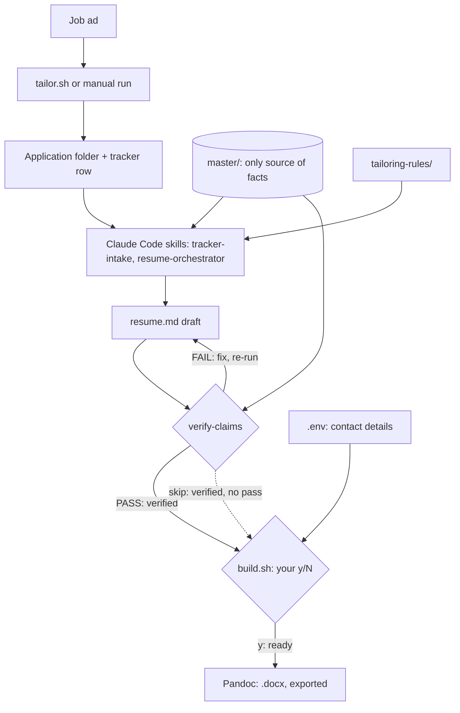

# Resume Tailoring Toolkit

Turn a job ad into a verified, claim-checked resume using agent skills and shell scripts.

**Contents:** [Why](#why) · [Architecture](#architecture) · [Setup](#setup) · [Workflow](#workflow) · [Status flow](#status-flow) · [Hard gates](#hard-gates) · [Scripts](#scripts) · [Private header](#private-header) · [Tags](#tags) · [Rules and maintenance](#rules-and-maintenance) · [Agents and skills](#agents-and-skills) · [Tests](#tests) · [Repository structure](#repository-structure)

## Why

Tailoring a resume for each job invites drift: a skill gets stretched, a number gets rounded up, a title changes. This repo stops that:

- One master file is the only source of facts.
- Every number must appear in a metrics log.
- A `verify-claims` step must pass before any resume can be exported, unless overridden with `skip` in `tailor.sh`.

### Who it is for

- Software developers and fresh graduates who want to automate most of their application process while juggling uni or other commitments.
- Job seekers who apply to many roles and want each resume tailored without inventing anything.
- People comfortable with a terminal, Git and [Claude Code](https://claude.com/claude-code). There is no GUI.
- Anyone who wants to keep personal data local, in plain files they own.

Not for you if you want a one-click web builder, auto-apply, or a tool that works without Claude Code, Pandoc and Bash.

### Why use it over alternatives

| Alternative                            | Gap                                                                                       | This repo                                                                                                  |
| -------------------------------------- | ----------------------------------------------------------------------------------------- | ---------------------------------------------------------------------------------------------------------- |
| Chatbot "tailor my resume" prompt      | Free to stretch skills, round numbers and invent details. Nothing checks the output.      | Facts and numbers come only from `master/`. `verify-claims` audits each draft against the master.          |
| Online resume builders                 | Your data lives on their service. Layout tools, not fact checks.                          | Everything stays in local files. Contact details live in a gitignored `.env`, never in drafts.             |
| Hand-edited Word copies                | Versions drift apart. Old bullets and numbers go stale or contradict each other.          | One master, one folder per application, status tracked in `applications/tracker.csv`, history in Git.      |

What you get that the alternatives do not give together:

- **Claim checking:** a failed audit blocks export unless you override it.
- **Human sign-off:** only your `y` at the `build.sh` prompt marks a resume `ready`.
- **Privacy rules:** private notes and unproven numbers cannot reach a resume or cover letter.
- **Plain files:** Markdown and CSV, so you can read, diff and back up everything.

Trade-off: setup takes effort, and verification is model-run, so read the final `.docx` yourself.

**Goal (V1):** turn a job description into a verified, one-to-two page resume (and optionally a cover letter) in one sitting, using the scripts and skills here. No API CLI, model API or database.

**Longer-term target:** [docs/PRODUCT-SPEC.md](docs/PRODUCT-SPEC.md). V1 is what the scripts and skills here already do.

## Architecture

Local Bash scripts orchestrate Claude Code skills over plain files. No services.



### Tech stack

| Layer               | Tool                                               |
| ------------------- | -------------------------------------------------- |
| Orchestration       | Bash (Git Bash on Windows)                         |
| Tracker edits       | gawk (quote-aware CSV)                             |
| Drafting and checks | Claude Code skills, `job-application-agent` plugin |
| Export              | Pandoc, Word reference templates                   |
| State               | Markdown, `applications/tracker.csv`, git          |
| CI                  | GitHub Actions                                     |

### Design decisions

| Decision                                       | Why                                                                                                                                                                |
| ---------------------------------------------- | ------------------------------------------------------------------------------------------------------------------------------------------------------------------ |
| No model API, Python or database               | Reuses existing scripts and skills. Add an API CLI only if agent sessions get too slow or costly.                                                                  |
| Agents may read private files, not output them | `verify-claims` needs them to catch leaks. `build.sh` never reads the side files and drops section 6.                                                              |
| Contact details stay in `.env`                 | Drafts hold placeholders. `build.sh` fills them only at the user-run docx build, outside the repo.                                                                 |
| Only `build.sh` sets `ready` and `exported`    | The y/N prompt is the human sign-off. `AGENTS.md` forbids agents setting these; no script enforces it.                                                             |
| Verification is model-run, with no hash check  | Citations wait until a verified draft is caught with an unsupported claim; hash checks until an edit goes unnoticed. Until then, re-verify after any edit by hand. |
| `tailor.sh` keeps a `skip` override            | Covers verifier false positives. It marks the draft `verified`; recording each use is planned, not built.                                                          |
| Git instead of draft revisions                 | Git keeps history, so no revision system is needed. Commit before re-running a skill; nothing commits for you.                                                     |
| Final page count checked by hand               | A `.docx` has no fixed page count. `verify-claims` only estimates it.                                                                                              |
| Submission stays manual                        | Auto-apply risks breaking job board terms.                                                                                                                         |

## Setup

### Prerequisites

`scripts/build.sh` needs the Pandoc executable (not the Python `pandoc` package).

- Install it from the [official instructions](https://pandoc.org/installing.html).
- Check with `pandoc --version`.
- Run scripts with `bash scripts/<name>.sh`. On Windows use Git Bash.
- `build.sh` and `set-status.sh` also need gawk. CI installs it.

**macOS:** install both with [Homebrew](https://brew.sh). The built-in awk lacks the quote-aware CSV support the scripts use, so gawk is required.

```bash
brew install pandoc gawk
```

### Plugin

The `job-application-agent` plugin is enabled for this project only (`.claude/settings.json`). To install it on a new machine, run from the repo root:

```bash
claude plugin marketplace add carriegale2710/job-application-agent --scope project
claude plugin install job-application-agent@job-application-agent --scope project
```

Its skills load only in sessions started in this repo. Restart the session or run `/reload-plugins` after installing.

### Use your own data (template folders)

`master/` and `applications/` hold the repo owner's data. Use the empty `-example` folders instead:

1. Rename `master-example/` to `master/` and `applications-example/` to `applications/`.
2. Fill `master/master-resume.md`. Leave every unknown as `TODO` and every `${...}` placeholder as written.
3. Copy `.env.example` to `.env` and fill in your contact details.

### Word templates

`.docx` styling comes from Word reference templates:

- `templates/resume-reference.docx`: resume. A4, 1.5 cm margins, Calibri 10 pt, navy ruled section headings.
- `templates/cover-letter-reference.docx`: letters. Optional; `build.sh` falls back to the resume template without it.

Pandoc takes only their styles, page size, margins and headers/footers, never their body content.

To change the look, open one in Word, modify the styles it uses and save: Heading 1 = name, Heading 2 = section, Body Text, First Paragraph, Compact = list items, Hyperlink.

## Workflow

**Shortcut:** `bash scripts/tailor.sh` (no arguments) does steps 1-4 interactively, in 6 steps:

- Asks for the company, role, URL, posting and closing date.
- Opens one Claude session per skill.
- Loops `verify-claims` until it passes.
- Offers a cover letter.
- At step 6, Enter runs `build.sh` (with its own y/N approval). `tailor.sh` exits once the row is `exported`. `c` re-checks status without building.

Every `tailor.sh` prompt takes `q` (quit); the `build.sh` y/N prompt does not. Pick an existing folder by number to resume.

**Step by step:**

### 1. Intake

```bash
bash scripts/new-application.sh acme-frontend
```

Paste the posting into `applications/<folder>/job-description.md`.

### 2. Tailor

In an agent session run `tracker-intake`, then `resume-orchestrator`. It analyses the posting, drafts with `resume-drafter`, reviews with `job-application-agent:application-lint` and pulls in other plugin skills as needed.

- The agent writes `resume.md` and never edits `master/`.
- Run `job-application-agent:cover-letter` only if a letter is needed.

To draft by hand, run the command below. Then pick the 5-7 strongest bullets, mirror only keywords the master supports, and cut to one page (two pages maximum).

```bash
bash scripts/build.sh --tags frontend,a11y,fullstack --md-only master/master-resume.md > applications/<folder>/resume.md
```

### 3. Verify

Run `verify-claims`. Any unsupported number, unsafe claim, private content or `TODO` blocks the next step. `tailor.sh` also offers `skip`, which marks the draft `verified` without passing.

### 4. Approve and export

Run the build yourself so `.env` fills the header. Answer `y` at the prompt to approve.

```bash
bash scripts/build.sh applications/<folder>/resume.md
```

The agent never sets `ready`. Editing a draft after verify means verifying again.

### 5. Submit

```bash
git add . && git commit -m "app: acme-frontend submitted" && git tag submit-YYYY-MM-acme
```

Then update the `tracker.csv` row.

### Not built yet

- **Page-count check:** `build.sh` does not fail above two pages. Check the .docx manually.

## Status flow

**Resume (`status`):** `pending` -> `tailored` -> `verified` -> `ready` -> `exported`

- `ready` and `exported` are both set by `build.sh` after your y/N approval.
- Building an `exported` resume asks "Re-export?" before overwriting.
- A resume build then tries the `cover-letter.md` beside it. It prompts only if `cover_letter_status` is `verified` or `exported`; otherwise it prints an error and moves on.

**Cover letter (`cover_letter_status`):** `none` -> `drafted` -> `verified` -> `exported`

**`tracker.csv` columns:** `id, date_applied, company, role, location, source, version_folder, status, last_update, contact, outcome, notes, opening_date, closing_date, eligibility, cover_letter_status`

## Hard gates

- Zero unsupported claims in anything `ready`. `skip` in `tailor.sh` can bypass this gate.
- Metrics only from `master/metrics-log.csv`, using its safe wording.
- Nothing from master section 6, `master/narrative-notes.md` or `master/archive.md` in output.
- One page target, two pages limit.

## Scripts

### `scripts/new-application.sh company-role`

- Creates `applications/<YYYY-MM>-company-role/` with `job-description.md`, `notes.md` and an empty `cover-letter.md`.
- Appends a `pending` row to `applications/tracker.csv`.
- Names allow ASCII letters, numbers and hyphens only.
- Refuses to overwrite a folder.

### `scripts/build.sh [--tags a,b] [--md-only] <input.md>`

- Filters bullets by tag.
- Drops master section 6 (and any later section), tag keys and blockquote notes.

With `--md-only`, it prints Markdown and never reads `.env`. Otherwise it:

1. Requires tracker status `verified` (or `exported`, which asks to confirm a re-export).
2. Asks `Approve <folder> <name> and build docx? [y/N]` (yes sets `ready`).
3. Warns if `TODO` remains.
4. Fills the `${RESUME_*}` header from `.env`.
5. Writes `~/Downloads/<folder>-<name>.docx` (override with `RESUME_OUT_DIR`), keeping each source line on its own line.
6. Sets the tracker status to `exported`.

For `cover-letter.md` it checks and updates `cover_letter_status` instead, and leaves `status` unchanged.

### `scripts/set-status.sh <folder> <status> [cover]`

- Sets `status` and `last_update` on the tracker row whose `id` is the folder name.
- With `cover`, sets `cover_letter_status` instead of `status`.
- Skills call it.
- `TRACKER` overrides the file.

### `scripts/tailor.sh`

Runs steps 1-4 interactively. See [Workflow](#workflow).

## Private header

Name, email, location, phone, links and work rights never live in the repo. Drafts use `${RESUME_NAME}`, `${RESUME_EMAIL}`, `${RESUME_LOCATION}`, `${RESUME_PHONE}`, `${RESUME_WORKRIGHTS}`, `${GITHUB_URL}`, `${LINKEDIN_URL}` and `${PORTFOLIO_URL}`.

Copy `.env.example` to a gitignored `.env` at the repo root and put your real values in `.env` (never in `.env.example`):

```
RESUME_NAME="Your Name"
RESUME_EMAIL="you@example.com"
RESUME_LOCATION="City, State"
RESUME_PHONE="04xx xxx xxx"
RESUME_WORKRIGHTS="Australian citizen"
GITHUB_URL="github.com/you"
LINKEDIN_URL="linkedin.com/in/you"
PORTFOLIO_URL="yourportfolio.com"
```

- The build substitutes them and fails if `.env` or a variable the draft uses is missing.
- The three `*_URL` values are optional: an unset one is dropped along with its `|` separator.
- Run the build yourself, not through an agent.
- `.claude/settings.json` denies Claude's Read tool on `.env` (best effort; shell commands are a separate path).

## Tags

`fullstack` `backend` `frontend` `qa` `ux` `a11y` `ai-eval` `devops` `product` `leadership` `security` `research` `ecommerce` `startup` `retail` `customer-service`

Summary-variant and add-on tags, and what each tag covers, live in `master/tags.md`.

## Rules and maintenance

**Rules:**

- `master/master-resume.md` is the source of truth.
- Edit canonical files only in `master/`, `.claude/skills/` or `AGENTS.md`.
- One `applications/YYYY-MM-company-role/` folder per application. Copy improved bullets to the master the same day.
- Log every number in `master/metrics-log.csv`.
- Master section references live in `AGENTS.md` and the skills. Keep them in sync if sections move.
- Keep this repo **private**.

**Schedule:**

| When      | Do                                        |
| --------- | ----------------------------------------- |
| Weekly    | Update master and metrics log             |
| Monthly   | Check links                               |
| Quarterly | Move stale bullets to `master/archive.md` |

## Agents and skills

- `AGENTS.md` holds the canonical rules. `CLAUDE.md` points to it.
- `.claude/skills/` holds the skills as plain Markdown.
- Skill order: `tracker-intake`, `resume-orchestrator`, `verify-claims`, then optionally `job-application-agent:cover-letter` and `job-application-agent:interview-prep`.
- General application skills come from the [`job-application-agent`](https://github.com/carriegale2710/job-application-agent) plugin. `AGENTS.md` maps its paths to this repo.

**Tools without file access:** paste `AGENTS.md` into the instructions and upload only the skill, master and job description needed. Never upload `master/metrics-log.csv`, `master/narrative-notes.md` or `master/archive.md` to tools you do not control.

## Tests

Tests use synthetic data and never read the private master. GitHub Actions runs them on push and PR. Run from the repo root:

```bash
bash tests/run-all.sh
```

| Test                      | Purpose                                                                                           |
| ------------------------- | ------------------------------------------------------------------------------------------------- |
| `test-build.sh`           | tag filtering, dropped private sections, `TODO` warning, `.env` header fill, missing-value errors |
| `test-master-split.sh`    | master stops at section 6; metrics log, skills inventory, narrative notes and archive files exist |
| `test-new-application.sh` | expected files, unsafe names rejected, duplicates refused, `pending` row added                    |
| `test-set-status.sh`      | `set-status.sh` updates only the matching row; unknown statuses and missing rows rejected         |
| `test-docx-export.sh`     | real .docx from a synthetic resume; skips without Pandoc                                          |
| `test-tailor.sh`          | `tailor.sh` flow with a stub `claude`: JD capture, step order, verify loop and `skip`, export     |
| `test-agent-fixtures.sh`  | runs the tailor skill on a temp copy with the dummy master; skips without the `claude` CLI        |

## Repository structure

```
master-resume/
├── README.md
├── AGENTS.md                      # canonical agent rules (edit this)
├── CLAUDE.md                      # one line: @AGENTS.md
├── ISSUES.md                      # open repo issues
├── .env.example                   # placeholder header values; copy to .env
├── .claude/
│   ├── settings.json              # denies Read on .env
│   └── skills/                    # <skill-name>/SKILL.md
├── .github/workflows/tests.yml
├── applications/                  # tracker.csv, archive/, one YYYY-MM-company-role/ folder per application
├── master/                        # master-resume.md, metrics-log.csv, skills-inventory.csv, narrative-notes.md, archive.md, tags.md
├── applications-example/          # empty template: rename to applications/ (see Setup)
├── master-example/                # empty template: rename to master/ (see Setup)
├── tailoring-rules/               # every-resume.md, by-role/ and by-company/ checklists
├── templates/                     # resume, cover letter, emails, LinkedIn/GitHub profile, case study, about me; *-reference.docx (Word styles)
├── examples/                      # job-desc-samples/
├── scripts/                       # build.sh, new-application.sh, set-status.sh, tailor.sh
├── tests/                         # run-all.sh, test-*.sh, fixtures/ (dummy master, side files, resume, sample application)
└── docs/                          # PRODUCT-SPEC.md, research/
```

Local only (gitignored): `.env`, `TODO.md`, `copilot/`, `.copilot/`, `.obsidian/`.
